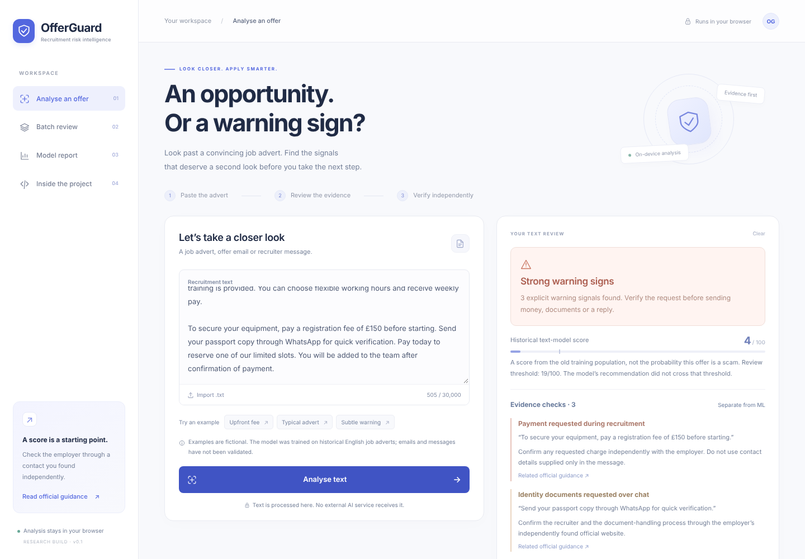
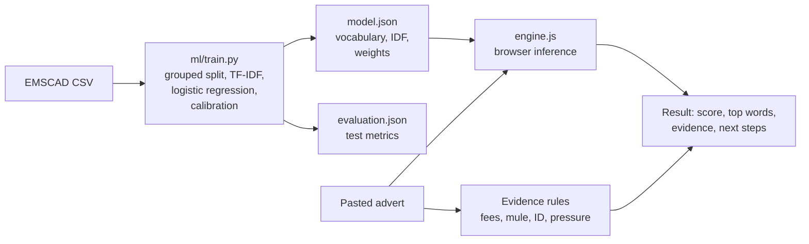

# OfferGuard

[](https://github.com/aryaniftikhar05-droid/OfferGuard/actions/workflows/ci.yml)
[](https://scikit-learn.org/)
[](dist/assets/engine.js)
[](LICENSE)

**Live demo:** [aryaniftikhar05-droid.github.io/OfferGuard](https://aryaniftikhar05-droid.github.io/OfferGuard/)

An explainable machine learning tool that helps job seekers spot recruitment scams.
Paste a job advert or recruiter message and OfferGuard shows explicit warning
signs (upfront fees, money-mule requests, passport requests over WhatsApp),
a calibrated text-model score, and what to verify next. Everything runs in the
browser: no server, no API key, and the text never leaves the device.



### Highlights

- **Trained, not prompted.** TF-IDF + logistic regression trained on 17,880
  labelled adverts (EMSCAD), with held-out sigmoid calibration.
- **Leakage-aware evaluation.** Company profiles and duplicate descriptions are
  grouped with union-find so no group crosses train/calibration/test.
- **Honest metrics.** 60.1% recall, 71.2% precision, 1.2% false positive rate,
  ROC-AUC 0.90 on an untouched test set, compared against a 95.2%-accuracy
  "always legitimate" baseline that catches zero scams.
- **Python training, JavaScript inference.** The model is exported to JSON and
  re-implemented in the browser; tests prove scores match scikit-learn to 1e-10.
- **Explainable.** Shows the words that pushed the score up, plus rule-based
  evidence with the exact sentence and official UK guidance links.
- **Safe by design.** Abstains on short or unsupported-language text, escapes
  all output, and protects CSV exports against formula injection.

### How it works




## What works

- Real ML: a trained TF-IDF (unigrams + bigrams) logistic regression model with
  held-out sigmoid calibration. 24,000 exported features; no paid AI API.
- Browser-local inference with Python/JavaScript prediction parity tests.
- Separate evidence rules for payment requests, personal-account transfers,
  identity documents over chat, urgency, guarantees and personal email.
- Input abstention for short, poorly covered or unsupported-language text.
- Single review with excerpts, next steps and JSON export.
- CSV batch review (100 rows, 2 MB), per-row validation and CSV export.
- A model report with false alarms, missed cases, slices and limitations.
- Plain text import, responsive UI, keyboard navigation and reduced-motion support.

Input is processed in the browser and is not sent to an inference server.
There is no analytics script, external font, API key, database or input history.
Exports happen only when requested. JSON exports include evidence excerpts but
omit the full original advert. Hosting and sign-in infrastructure still handles
ordinary page requests; this is not a claim of zero infrastructure logs.

## Run the app

The site is buildless. Serve the `dist` folder over HTTP:

```sh
python3 -m http.server 8000 --directory dist
```

Open `http://localhost:8000`. All assets are included. Model loading uses `fetch`,
so opening `index.html` directly as a local file will not work in many browsers.
Local hosting has no authentication. No API credentials or inference server are
required.

## Automated checks

GitHub Actions runs the JavaScript tests, the Python/JavaScript parity tests and
Python syntax checks on every push and pull request. A second workflow deploys
`dist/` to GitHub Pages after the tests pass. Run the same checks locally with:

```sh
npm test                      # 12 engine tests, incl. Python/JS score parity
python3 -m pytest -q tests    # preprocessing parity between Python and JS
```

## Reproduce training

Use Python 3.11 or newer. Data is not included; read DATA_CARD.md first.

```sh
python3 -m venv .venv
source .venv/bin/activate
python3 -m pip install -r requirements.txt
python3 ml/download_data.py
python3 ml/train.py --csv data/raw/emscad_v1.csv
node --test tests/*.test.mjs
```

Node 20+ runs the dependency-free JavaScript tests. Training replaces the exported
model, report, split indices and parity fixtures. Changing a model requires
revalidating inference parity (`npm test`).

## Evaluation

EMSCAD contains 17,880 adverts, including 866 labelled fraudulent, published in
2012–2014. Matching normalised company profiles and exact descriptions are
joined into groups before a seeded 60/20/20 train/development/test split.
No identified group crosses a fold. Unknown-company overlap and near-duplicate
leakage are **not** ruled out. No location, company name, company profile, logo,
education or applicant attribute is directly supplied to the model; incidental
identifiers in advert text can still be learned.

The vectorizer is fitted only on training data. The development fold is used for
sigmoid calibration and maximum-F2 threshold selection. Using that same fold for
both is a development shortcut; only the untouched test results are reported as
test performance. The learned review threshold is 0.19.

| Test result | Count |
| --- | ---: |
| Scams correctly flagged | 104 |
| Scams missed | 69 |
| Legitimate adverts falsely flagged | 42 |
| Legitimate adverts not flagged | 3,361 |

Recall: 60.1%. Precision: 71.2%. False positive rate: 1.23%. Average precision:
0.617, against positive prevalence of 0.048. The all-legitimate baseline gets
95.2% accuracy and catches no scams. **These metrics evaluate only the text model,
not the combined rule/abstention policy.**

There are only two labelled UK scams in the test set; neither was flagged by the
model. This cannot support a claim of UK effectiveness. The historical model was
not validated on present-day offer emails, chat messages, documents, visas or
sponsor decisions. Its score is not a current real-world fraud probability.

A concrete example of domain shift: the fictional upfront-fee message in the
screenshot above scores only 4/100 from the historical text model, because modern
chat-style scams do not look like 2012–2014 job adverts. It is still flagged as
"Strong warning signs" by the evidence rules. This is why the two layers are kept
separate and shown side by side.

Full reproducibility information: `dist/assets/evaluation.json` and `ml/split.json`.
The test set has now been inspected. Future model development should use new
development data and a fresh held-out evaluation rather than repeatedly tuning
against this test result.

## Architecture

`ml/text.py` mirrors `dist/assets/engine.js` preprocessing. `ml/train.py` learns
the vocabulary, inverse document frequencies, classifier coefficients and
calibration parameters. These values are exported to `model.json`.

`engine.js` computes sublinear term-frequency, TF-IDF, L2 normalisation, a linear
logit and sigmoid-calibrated score. Positive feature contributions can be
inspected. Separate regex policies extract evidence and cite official guidance.
They are incomplete heuristics, not an independently validated scam detector.
Negation handling is conservative and sentence based, not full language
understanding; sophisticated rewrites can evade it or produce false alarms.

`app.js` renders results using escaped text. It never fetches URLs in an advert
or executes supplied content. CSV export prefixes formula-like values to reduce
spreadsheet injection risk. Browser analysis has no external inference call.

## Validation

Fourteen tests check real Python/JS inference parity, payment and
money-mule warnings, negation, abstention, unsupported language, input limits,
CSV quoting, formula-injection protection and evaluation consistency.
Browser QA covers example analysis, report navigation and batch import.
See VALIDATION.md for the performed checks and any limits.

## Ambitious next stages — not implemented

1. A recent, consented, independently labelled multi-platform dataset. Split by
   employer, campaign and time, with a sealed final test set.
2. Independent evidence retrieval: confirm a role on the employer's official
   domain, recruiter contact consistency and official records. Company existence
   alone must never count as offer authenticity.
3. Compare character models and modern text encoders against this baseline using
   precision/recall, calibration, latency, robustness and human review workload.
4. Offer an opt-in correction workflow with consent, retention controls and
   independent moderation. Corrections must not silently become training labels.
5. Run a blinded user study to measure whether the tool improves decisions and
   avoids giving false reassurance. No impact claim is currently established.

## Sources and reuse

Vidros et al. (2017), *Automatic Detection of Online Recruitment Frauds:
Characteristics, Methods, and a Public Dataset*:
https://doi.org/10.3390/fi9010006

Official UK recruitment-scam advice:
https://www.reportfraud.police.uk/recruitment-scams/

NCSC suspicious-message guidance:
https://www.ncsc.gov.uk/collection/phishing-scams/spot-scams

Developed with AI coding assistance. Code is MIT licensed. The dataset and learned artifacts have separate provenance
and reuse considerations described in DATA_CARD.md. Raw adverts are not included.
